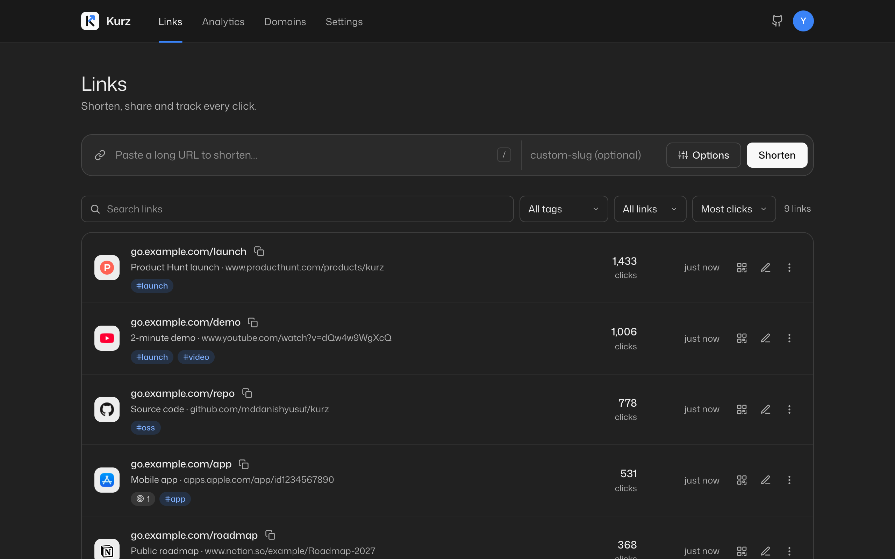
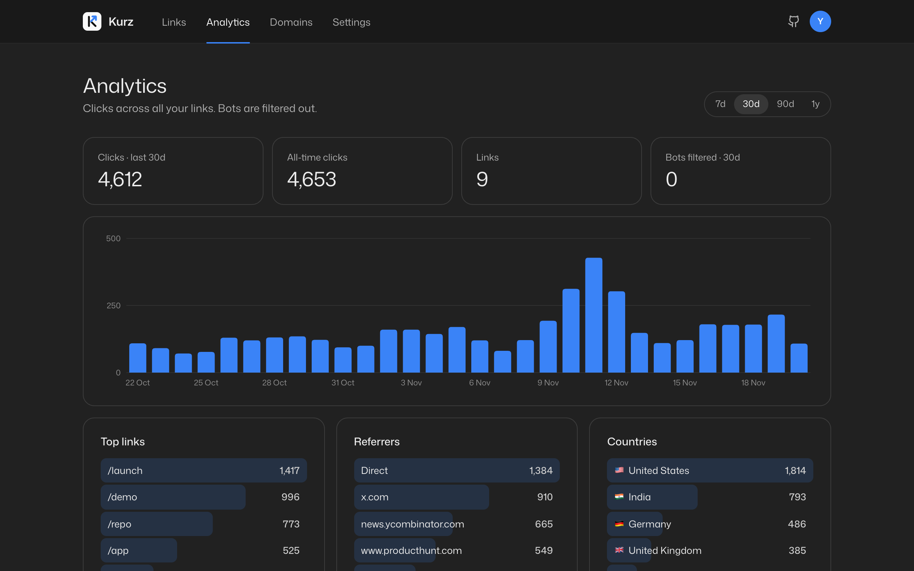
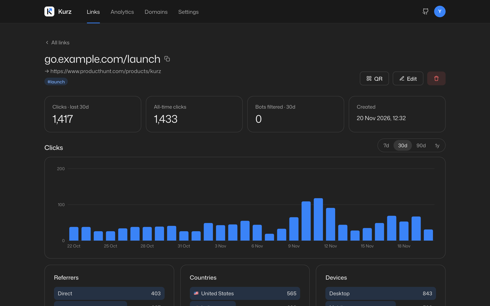
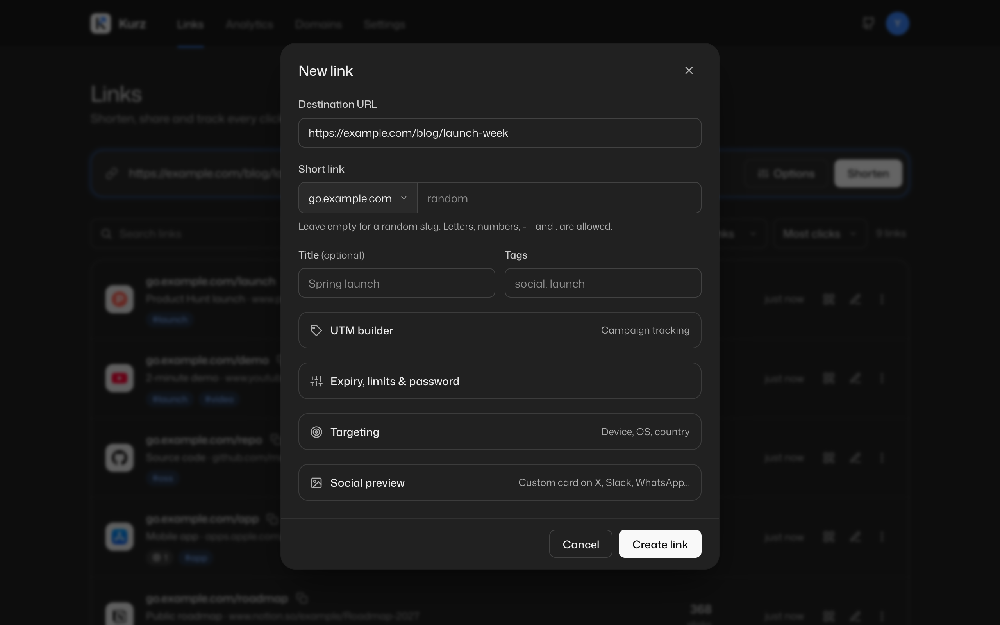
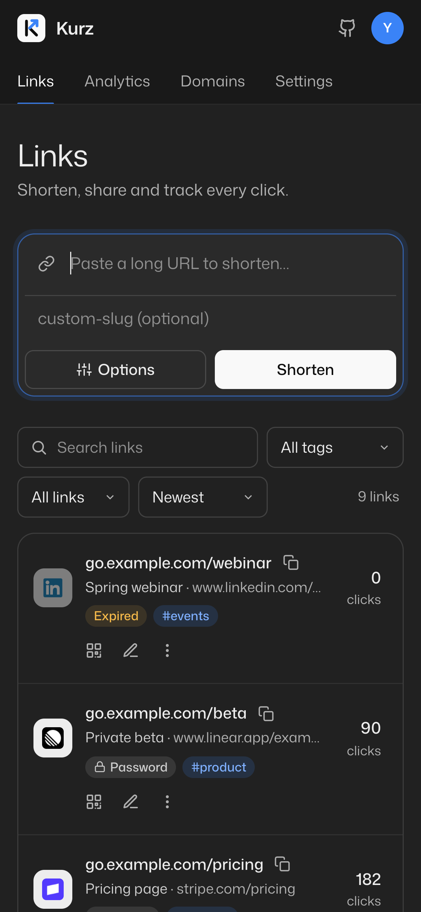

<div align="center">


# Kurz

**A fast, open-source link shortener that runs entirely on Cloudflare.**<br>
Your domains, private analytics, one Worker, and it fits in the free plan.

[](https://deploy.workers.cloudflare.com/?url=https://github.com/mddanishyusuf/kurz)

[Features](#features) · [Deploy](#deploy) · [Custom domains](#custom-domains) · [API](#api) · [Configuration](#configuration)

<br>



</div>

<br>

## Why Kurz

- **Free to run.** Everything lives on Cloudflare Workers, KV and D1. A personal or small-team setup costs nothing.
- **Fast redirects.** Links are read from KV at the edge. The redirect never waits on the database.
- **Your domains.** Add `go.yourdomain.com` from the dashboard and Kurz sets up DNS and SSL for you.
- **Private by default.** No cookies, no third-party scripts. Analytics stay in your own database.
- **No setup steps.** No migrations or external services. Deploy, open `/_/`, pick a password.

## Features

<table>
<tr>
<td width="50%" valign="top">

**Links**
- Random or custom slugs, 301 or 302
- Edit, disable or delete any time
- Tags, search, filters and sorting
- QR codes as SVG or PNG
- UTM builder
- Query strings pass through: `go.co/x?ref=tw` → `destination?ref=tw`

</td>
<td width="50%" valign="top">

**Controls**
- Expiry date, with an optional fallback URL
- Click limits
- Password-protected links
- Targeting: send iOS, Android, mobile or certain countries to a different URL
- Custom social preview for X, Slack, WhatsApp and LinkedIn

</td>
</tr>
<tr>
<td valign="top">

**Analytics**
- Clicks over time, by link or across all links
- Referrers, countries, devices, browsers, OS
- Bots are recorded but not counted
- No cookies or fingerprinting

</td>
<td valign="top">

**Admin**
- One admin password, reset by email through Cloudflare
- Custom domains added from the dashboard
- REST API with tokens
- CSV import and export
- Works on phones

</td>
</tr>
</table>

<table>
<tr>
<td width="50%"></td>
<td width="50%"></td>
</tr>
<tr>
<td width="50%"></td>
<td width="50%" align="center"></td>
</tr>
</table>

## Deploy

### One click

1. Click **Deploy to Cloudflare** above. Cloudflare copies the repo to your GitHub, creates the KV namespace and D1 database, and deploys it.
2. Open `https://kurz.<your-subdomain>.workers.dev/_/` and create your admin account.

### From your machine

```bash
git clone https://github.com/mddanishyusuf/kurz && cd kurz
npm install
npx wrangler login
npm run deploy
```

Wrangler creates the KV namespace and D1 database on the first deploy. Then open `/_/` on your Worker URL.

> [!IMPORTANT]
> The first person to open `/_/` becomes the admin, so do it right after deploying.
> To lock setup to your email, set `ADMIN_EMAIL` in `wrangler.jsonc` before you deploy.

## Custom domains

The domain's DNS has to be on Cloudflare.

**Automatic (recommended).** Connect Cloudflare once:

1. In Kurz, open **Settings → Cloudflare** and follow the link to create an API token. It needs **Workers Scripts: Edit**, **Workers Routes: Edit** and **Zone: Read**; the “Edit Cloudflare Workers” template also works.
2. Paste the token and click **Connect**. If you'd rather keep it as a secret, run `npx wrangler secret put CF_API_TOKEN` instead.
3. Go to **Domains → Add domain** and enter a hostname such as `go.example.com`.

Kurz attaches the domain to the Worker, and Cloudflare creates the DNS record and SSL certificate. HTTPS can take a few minutes the first time. Removing a domain in Kurz also removes it from Cloudflare.

<details>
<summary><b>Manual setup</b></summary>
<br>

1. In Cloudflare, go to **Workers & Pages → kurz → Settings → Domains & Routes → Add → Custom domain** and enter the hostname.
2. Add the same hostname in Kurz under **Domains**.

Don't create the DNS record yourself. A plain CNAME to `*.workers.dev` gives error 525.
You can also list domains in `wrangler.jsonc`:

```jsonc
"routes": [{ "pattern": "go.example.com", "custom_domain": true }]
```

</details>

Links set to **Any domain** work on every connected hostname, and links tied to a domain only work there.
To keep the dashboard off your short domains, set `ADMIN_HOST`, for example `admin.example.com`.

## Password reset

Kurz emails reset links through Cloudflare Email Routing:

1. Turn on **Email Routing** for a domain in Cloudflare (**Email → Email Routing**).
2. Add your admin email as a **verified destination address**.
3. Set `EMAIL_FROM` in `wrangler.jsonc` to an address on that domain, such as `kurz@example.com`, and deploy again.

No email set up? Reset from your terminal:

```bash
npm run set-password            # production
npm run set-password -- --local # local dev
```

## Configuration

Set these under `vars` in `wrangler.jsonc`.

| Variable | Default | What it does |
|---|---|---|
| `EMAIL_FROM` | empty | Sender for reset emails. Empty turns email reset off |
| `ADMIN_EMAIL` | empty | Only this email can complete first-time setup |
| `ADMIN_HOST` | empty | Serve the dashboard and API only on this hostname |
| `CLICK_RETENTION_DAYS` | `365` | Delete click records older than this. `0` keeps them forever |
| `WORKER_NAME` | `kurz` | The Worker custom domains are attached to. Keep it the same as `name` |
| `CF_API_TOKEN` | — | Optional secret for automatic domains, instead of saving the token in Settings |

The root redirect, 404 redirect, default 301/302 and click tracking are set in **Settings**.

## API

Create a token in **Settings → API tokens**.

```bash
# Create a link
curl -X POST https://go.example.com/_/api/links \
  -H "Authorization: Bearer kurz_…" \
  -H "Content-Type: application/json" \
  -d '{"url":"https://example.com/launch","slug":"launch","tags":["social"]}'

# Search links
curl "https://go.example.com/_/api/links?q=launch&limit=20" \
  -H "Authorization: Bearer kurz_…"
```

<details>
<summary><b>All endpoints</b></summary>
<br>

| Method | Path | Notes |
|---|---|---|
| `GET` | `/_/api/links` | `q`, `tag`, `domain`, `status` (active, expired, disabled), `sort` (newest, oldest, clicks), `page`, `limit` |
| `POST` | `/_/api/links` | `url` is required. Optional: `slug`, `domain`, `title`, `tags`, `redirect_type`, `password`, `expires_at`, `expired_url`, `max_clicks`, `rules`, `og_title`, `og_description`, `og_image` |
| `POST` | `/_/api/links/bulk` | `{ "links": [...] }`, up to 100 per request |
| `GET` `PATCH` `DELETE` | `/_/api/links/:id` | `PATCH` takes any field from create, plus `disabled` |
| `GET` | `/_/api/links/:id/stats` | `days` (1–365), `tz` (minutes, as from `getTimezoneOffset()`) |
| `GET` | `/_/api/links/export` | CSV |
| `GET` | `/_/api/stats` | Overview across all links |
| `GET` `POST` `PATCH` `DELETE` | `/_/api/domains[/:id]` | |
| `GET` | `/_/api/tags` | |

A targeting rule looks like `{ "type": "os" | "device" | "country", "value": "ios" | "mobile" | "us,ca", "url": "https://…" }`. The first rule that matches wins.

</details>

## How it works

```
visitor ──▶ Worker ──┬──▶ KV   slug → destination, read at the edge
                     └──▶ D1   links, clicks, settings (clicks logged after the redirect)
admin   ──▶ /_/      ──▶ Preact dashboard, served as static assets by the same Worker
```

The D1 schema is created on first use, so there's no migration step.

**Free plan limits.** Workers allow 100k requests a day. Each counted click costs about 2 D1 row writes, so around 50k clicks a day fit in D1's 100k daily writes, and you can turn click tracking off in Settings. KV is written only when links or domains change, never on clicks. Passwords use PBKDF2-SHA256 at 50k iterations to stay within the free CPU limit, and login and reset are limited to 5 tries a minute per IP.

## Development

```bash
npm install
npm run dev        # builds the dashboard and runs the Worker at http://localhost:8787/_/
npm run dev:ui     # optional: hot reload for the dashboard (proxies the API to :8787)
npm test
npm run typecheck
```

Local dev uses local KV and D1. To try reset emails, run `npx wrangler dev --var EMAIL_FROM:kurz@example.com`. Wrangler saves each email as an `.eml` file and prints its path.

```
src/worker/   Hono app: redirects, auth, admin API, D1 schema
src/ui/       Preact dashboard, built into dist/ui/_/
scripts/      set-password CLI
test/         unit tests
```

## License

[MIT](LICENSE)
